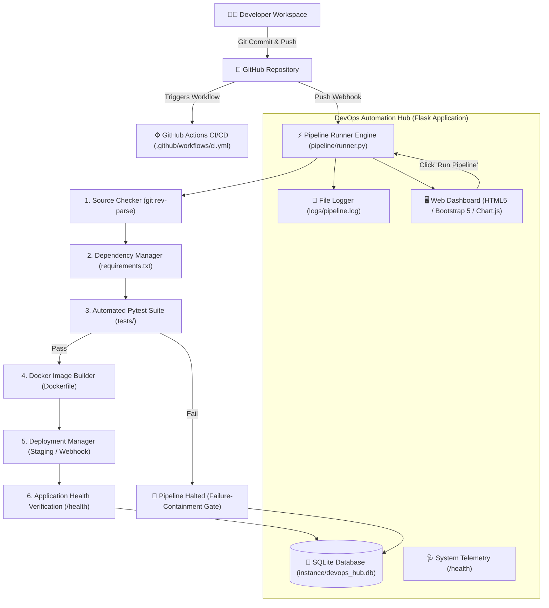

# 🚀 DevOps Automation Hub

**Automated Build, Testing, Containerization, Deployment and Monitoring System**

[](https://github.com/swati/DevOps-Automation-Hub/actions)
[](https://www.python.org/)
[](https://palletsprojects.com/p/flask/)
[](https://docs.pytest.org/)
[](https://www.docker.com/)
[](LICENSE)

---

## 📖 Executive Summary & Project Objective

**DevOps Automation Hub** is an automated web-based platform that unifies and demonstrates the core phases of the modern software engineering lifecycle:
1. **Source Code Inspection & Version Control** (Git & GitHub)
2. **Environment & Dependency Verification** (Python & Pip)
3. **Automated Testing & Quality Gates** (Pytest suite)
4. **Containerization & Image Build** (Docker & Docker Compose)
5. **Continuous Deployment / Delivery** (Staging release & Webhook dispatch)
6. **Application Telemetry & Health Monitoring** (`/health` probe & CPU/RAM metrics)
7. **Audit Logging & Execution History** (SQLite database & log streaming)

Built specifically as a 20-mark college-level DevOps capstone project, it bridges theoretical DevOps principles with a real, functional software engineering dashboard. It avoids fabricated success states: if tests fail, the pipeline halts immediately; if Docker is unavailable on the host, the stage is accurately marked as **SKIPPED**; and health statuses represent live HTTP endpoint responses.

---

## 🏛️ System Architecture



---

## 📁 Project Structure

```text
DevOps-Automation-Hub/
├── .github/
│   └── workflows/
│       └── ci.yml               # Automated GitHub Actions CI/CD workflow
├── config/
│   ├── __init__.py
│   └── settings.py              # Centralized environment & app settings
├── database/
│   ├── __init__.py
│   └── db.py                    # SQLite connection & CRUD functions
├── instance/
│   └── devops_hub.db            # Persistent SQLite database file
├── logs/
│   └── pipeline.log             # Physical log file
├── monitoring/
│   ├── __init__.py
│   └── monitor.py               # Real-time CPU, RAM, Disk, Uptime metrics
├── pipeline/
│   ├── __init__.py
│   ├── runner.py                # Pipeline orchestrator
│   ├── source_checker.py        # Git commit, branch & working tree validator
│   ├── dependency_manager.py    # Python package validator
│   ├── test_runner.py           # Pytest runner with failure simulation hook
│   ├── docker_manager.py        # Genuine Docker builder & diagnostic provider
│   ├── deployment_manager.py    # Staging & Cloud Webhook delivery manager
│   └── health_checker.py        # Authentic /health probe validator
├── static/
│   ├── css/
│   │   └── style.css            # Custom SaaS UI styles (White + Blue & Purple)
│   └── js/
│       ├── main.js              # Navigation, toasts, global health poll
│       ├── dashboard.js         # Chart.js graphs & metric widgets
│       ├── pipeline.js          # Interactive pipeline runner & live terminal
│       └── monitoring.js        # Real-time resource gauges & probe inspector
├── templates/
│   ├── base.html                # Sidebar layout & base template
│   ├── dashboard.html           # Module 1: Dashboard Overview
│   ├── pipeline.html            # Module 2: CI/CD Pipeline Execution
│   ├── history.html             # Module 6: Build History & Modal Breakdown
│   ├── testing.html             # Module 3: Automated Testing & Gate Architecture
│   ├── docker.html              # Module 4: Docker Status & Dockerfile Viewer
│   ├── deployment.html          # Module 5: Deployment Environments & Delivery
│   ├── monitoring.html          # Module 7: Application Monitoring & /health
│   └── logs.html                # Module 8: Execution Logs & Level Filtering
├── tests/
│   ├── __init__.py
│   ├── test_app.py              # Endpoint availability, /health, /api/metrics
│   ├── test_functionality.py    # Database schema, math logic, failure hook
│   └── test_api.py              # View rendering & GitHub webhook tests
├── Dockerfile                   # Multi-stage production container specification
├── docker-compose.yml           # Compose service with health check & volumes
├── requirements.txt             # Project dependencies (Flask, Pytest, Requests, Psutil)
├── .gitignore                   # Git exclusions
├── app.py                       # Main Flask web server entrypoint
└── README.md                    # Project documentation
```

---

## 🛠️ Technology Stack

| Layer | Technology | Purpose |
|---|---|---|
| **Frontend** | HTML5, CSS3, JavaScript (ES6+), Bootstrap 5.3, Chart.js, Bootstrap Icons | Modern, responsive dashboard with blue/purple SaaS styling |
| **Backend** | Python 3.11+ / 3.13+, Flask | Modular REST API and dynamic Jinja2 view rendering |
| **Database** | SQLite 3 (`instance/devops_hub.db`) | Lightweight persistence for pipeline runs, test records, logs |
| **Version Control**| Git & GitHub | Source tracking, commits, branches, webhook integration |
| **CI/CD** | GitHub Actions (`.github/workflows/ci.yml`) | Automated checkout, linting, testing, Docker build on push |
| **Containerization**| Docker & Docker Compose | Container packaging, port mapping, isolated deployment |
| **Testing** | Pytest | Automated unit, integration, and HTTP smoke tests |
| **Monitoring** | `/health` endpoint & `psutil` | Live service health check, latency measurement, system metrics |
| **Logging** | Python `logging` & SQLite audit stream | Structured timestamped logs recorded to file and UI console |

---

## ⚡ Installation & Execution Guide

### Prerequisites
- Python 3.10+ installed ([python.org](https://www.python.org/downloads/))
- Git installed ([git-scm.com](https://git-scm.com/))
- (Optional) Docker Desktop if you wish to run the containerized deployment locally.

### Step 1: Open Terminal in Project Directory
```powershell
cd "c:\Users\swati\Desktop\DevOps Automation Hub"
```

### Step 2: Install Required Dependencies
```powershell
pip install -r requirements.txt
```

### Step 3: Run the Automated Test Suite (Pytest)
```powershell
python -m pytest tests/ -v
```
*All tests should pass with green checkmarks.*

### Step 4: Start the DevOps Automation Hub
```powershell
python app.py
```

### Step 5: Open Dashboard in Your Web Browser
Navigate to:
```text
http://localhost:5000
```

---

## 🐳 Running with Docker

If Docker Desktop is installed and running on your system:

### Option A: Build and Run with Dockerfile
```powershell
# 1. Build the container image
docker build -t devops-automation-hub:latest .

# 2. Run container on port 5000
docker run -d -p 5000:5000 --name devops_hub devops-automation-hub:latest

# 3. Check container logs
docker logs devops_hub

# 4. Probe container health
curl http://localhost:5000/health
```

### Option B: Run via Docker Compose
```powershell
docker compose up -d
```
To stop:
```powershell
docker compose down
```

---

## 🎬 Step-by-Step Project Demonstration (College Exam / Viva)

To present this project and secure full marks, follow this demonstration script:

### 1. Dashboard Overview (`/`)
- Open `http://localhost:5000`.
- Point out the **Metric Cards**: Total Runs, Successful Builds, Failed Builds, and Latest Run Status.
- Explain the **Build Success Ratio** doughnut chart and **Duration History** bar chart.
- Note the topbar health indicator dynamically pulling from `/health`.

### 2. CI/CD Pipeline Execution (`/pipeline`)
- Click **Launch Pipeline Console** or open the Pipeline tab in the sidebar.
- Click **Run Pipeline (Standard)**.
- Watch the live visual stepper advance through:
  1. *Source Check* &rarr; validates git commit and working tree.
  2. *Dependencies* &rarr; confirms Flask, pytest, psutil.
  3. *Automated Tests* &rarr; executes pytest suite.
  4. *Docker Build* &rarr; checks Docker availability (safely reports SKIPPED if daemon is off).
  5. *Deployment* &rarr; registers Local Staging release.
  6. *Health Probe* &rarr; queries `/health` with HTTP 200 OK.
- Review the terminal output in the dark console window.

### 3. Demonstrating Failure-Containment (Quality Gate)
- On the same Pipeline page, click **Run Pipeline (Simulate Failure)**.
- Observe:
  - Pytest detects an assertion error in `test_pipeline_failure_simulation`.
  - The pipeline **halts immediately**.
  - Subsequent Docker and Deployment stages are marked **SKIPPED** to protect production.
  - Overall status is marked **FAILED** with an alert banner.
- Explain to the examiner: *"This demonstrates the DevOps principle of 'failing fast' and preventing broken code from ever being built or deployed."*

### 4. Build History & Audit Trail (`/history`)
- Click **Build History** on the sidebar.
- Show the table containing both the successful run and the failed run.
- Click **Details** on any row to open the modal breakdown showing individual test timings and captured logs.

### 5. Automated Testing Breakdown (`/testing`)
- Click **Testing Results**.
- Walk through the 7 automated test cases:
  1. Homepage availability (`test_homepage_availability`)
  2. Health endpoint (`test_health_endpoint`)
  3. Backend API metrics (`test_backend_api_metrics`)
  4. Backend system status (`test_backend_api_status`)
  5. SQLite schema connectivity (`test_database_connectivity`)
  6. Calculation utility (`test_calculation_utility`)
  7. Failure simulation hook (`test_pipeline_failure_simulation`)

### 6. Docker Containerization Diagnostics (`/docker`)
- Click **Docker Status**.
- Show the host Docker diagnostic information.
- Review the embedded `Dockerfile` (explaining the 5 steps: base image, requirements, copy files, expose 5000, start Flask).
- Review `docker-compose.yml`.

### 7. Deployment Status & Webhook (`/deployment`)
- Click **Deployment Status**.
- Explain the staging target vs optional cloud webhook.
- Explain how GitHub push events send payloads to `/api/webhook/github` to trigger automated runs.

### 8. Live Application Monitoring (`/monitoring`)
- Click **App Monitoring**.
- Show the real-time resource utilization gauges (CPU %, RAM %, Disk %).
- Click **Send Health Probe Ping** to perform an on-demand probe to `/health`.
- Show the raw JSON payload with response latency (e.g. `1.5 ms`).

### 9. Execution Logs (`/logs`)
- Click **Execution Logs**.
- Filter logs by `ERROR`, `SUCCESS`, and `INFO`.
- Click **Download log** to inspect `logs/pipeline.log`.

---

## 💡 Key Viva Questions & Answers

**Q1: What is the primary purpose of a CI/CD pipeline?**  
*Answer:* CI/CD (Continuous Integration and Continuous Delivery/Deployment) automates building, testing, containerizing, and deploying code. It minimizes manual human error, shortens release cycles, and ensures every code commit passes strict automated quality gates before release.

**Q2: Why does the pipeline halt when a test fails?**  
*Answer:* That is the core quality gate in DevOps. If broken code is allowed to proceed to the Docker build or Deployment stage, defects would reach staging or production environments. Halting immediately protects system reliability.

**Q3: How does the system avoid fake/fabricated results?**  
*Answer:* The pipeline executes genuine system subprocesses (`git`, `pytest`, `docker`). If Docker CLI or the daemon is not running on the host machine, it accurately reports the status as `SKIPPED (Docker daemon not detected)` rather than falsely claiming success.

**Q4: What information does `/health` return?**  
*Answer:* It returns a JSON object containing `status: "healthy"`, the service name, version, current ISO timestamp, uptime in seconds, database connectivity status, and system resource telemetry (CPU, Memory, Disk).

---

## 📄 License
This project is open-source and developed for educational purposes under the MIT License.
